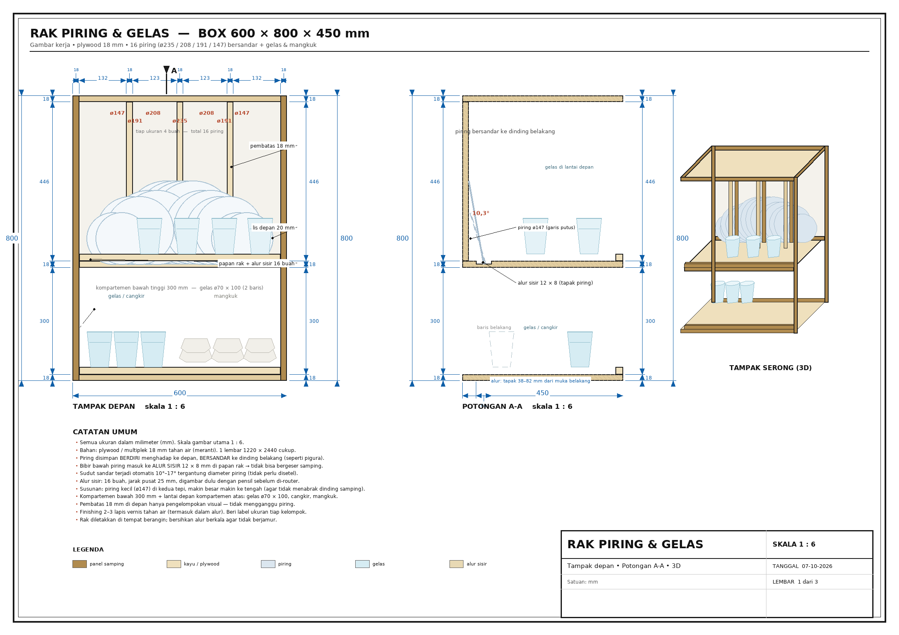
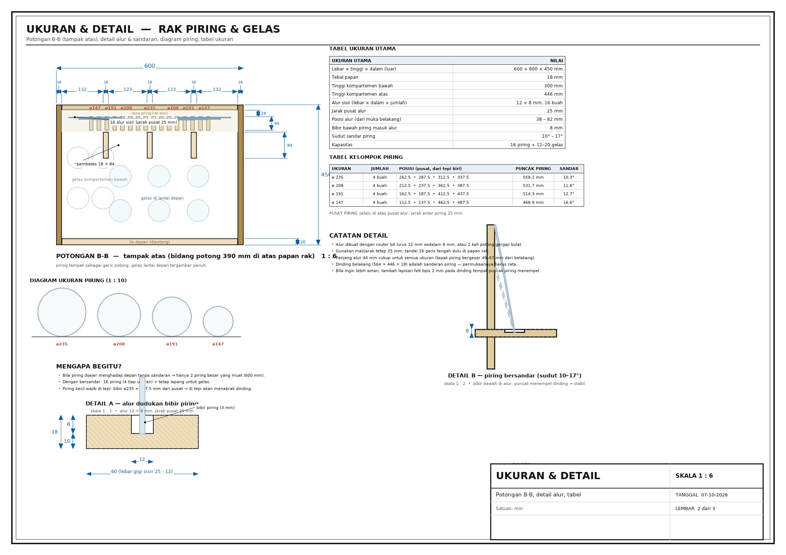

# Rak Piring & Gelas — Box 600 × 800 × 450 mm

Gambar kerja lengkap untuk rak piring berbentuk box yang dapat menampung **4 ukuran piring**
(ø23 cm, ø20,8 cm, ø19,1 cm, ø14,7 cm) **sekaligus gelas/mangkuk**, dibuat dari 1 lembar plywood 18 mm.



---

## 1. Keputusan rancangan (penting)

Pertanyaan awalnya: bagaimana memasukkan 4 ukuran piring ke dalam box selebar 60 cm?

| Cara simpan | Hasil |
|---|---|
| Piring **menghadap depan**, berdiri bebas (tumpuk seperti di lemari restoran) | hanya **2 piring besar** (ø23) yang muat — 60 cm terlalu sempit |
| Piring **berdiri miring / menghadap samping** | bibir ø23 = 117,5 mm dari pusat → **menabrak dinding samping** |
| ✅ **Piring menghadap depan, BERSANDAR ke dinding belakang** | **16 piring** (4 tiap ukuran) + ruang lega untuk gelas |

Cara yang dipakai (paling umum pada rak piring gantung/standing kayu):

- Piring **berdiri menghadap ke depan**, bersandar ke dinding belakang — seperti pigura bersandar di dinding.
- **Bibir bawah piring masuk ke alur** (12 × 8 mm) pada papan rak → piring tidak bisa bergeser samping atau menggelinding.
- Sudut sandar **muncul otomatis** (10°–17°, tergantung diameter) karena tapak piring 60 mm dari muka belakang,
  sementara puncak piring menyentuh dinding belakang (18 mm). Tidak perlu disetel apa pun.
- Piring **kecil (ø14,7) wajib di alur tepi**, piring besar di tengah: bibir ø23 = 117,5 mm dari pusat, kalau ditaruh
  di tepi akan menabrak dinding samping.

---

## 2. Spesifikasi

| Item | Nilai |
|---|---|
| Ukuran luar (lebar × tinggi × dalam) | **600 × 800 × 450 mm** |
| Bahan | plywood / multiplek **18 mm** tahan air (meranti) |
| Kompartemen atas (piring) | tinggi 446 mm (dari papan rak ke papan atas) |
| Kompartemen bawah (gelas) | tinggi 300 mm |
| Alur dudukan piring | **16 alur, 12 × 8 × 44 mm**, jarak pusat **25 mm** |
| Posisi alur | 38–82 mm dari muka belakang |
| Sudut sandar piring | 10,3° (ø235) · 11,6° (ø208) · 12,7° (ø191) · 16,6° (ø147) |
| **Kapasitas** | **16 piring** (4 × ø235, 4 × ø208, 4 × ø191, 4 × ø147) + **12–20 gelas/mangkuk** |
| Bahan terpakai | 1,87 m² dari 1 lembar 1220 × 2440 (2,98 m²) — sisa ± 1,11 m² |

### Posisi piring (pusat alur, dari tepi kiri box)

```
ø147   ø147   ø191   ø191   ø208   ø208   ø235   ø235   ø235   ø235   ø208   ø208   ø191   ø191   ø147   ø147
112,5  137,5  162,5  187,5  212,5  237,5  262,5  287,5  312,5  337,5  362,5  387,5  412,5  437,5  462,5  487,5
```

### Tinggi puncak piring

| Ukuran | Puncak piring | Sisa ke papan atas |
|---|---|---|
| ø235 | 559 mm | 223 mm |
| ø208 | 532 mm | 250 mm |
| ø191 | 514 mm | 268 mm |
| ø147 | 469 mm | 313 mm |

---

## 3. Gambar kerja

| Lembar | File | Isi |
|---|---|---|
| 1 | `gambar/01-tampak-umum.png` / `.svg` | Tampak depan (1:6), potongan A-A (1:6), tampak 3D, catatan umum |
| 2 | `gambar/02-ukuran-detail.png` / `.svg` | Potongan B-B / tampak atas, detail alur 1:1, detail sandaran, tabel ukuran |
| 3 | `gambar/03-pembuatan.png` / `.svg` | Daftar potongan, kebutuhan bahan, denah pemotongan 1 lembar, langkah perakitan |

File **SVG** bisa diperbesar tanpa pecah (untuk dicetak A3 atau dikirim ke tukang).



---

## 4. Daftar potongan (plywood 18 mm)

| Kode | Bagian | Qty | Ukuran (P × L) |
|---|---|---|---|
| A | Panel samping kiri / kanan | 2 | 800 × 450 |
| B | Papan bawah, papan rak, papan atas | 3 | 564 × 450 |
| C | Dinding belakang (sandaran piring) | 1 | 564 × 446 |
| D | Pembatas / sekat depan | 3 | 446 × 84 |
| E | Lis depan (atas & bawah) | 2 | 564 × 20 |

**Tambahan pekerjaan:** 16 alur 12 × 8 × 44 mm pada papan rak (jarak pusat 25 mm, mulai 112,5 mm dari tepi kiri).

Semua bagian di atas masuk **1 lembar plywood 1220 × 2440** — denah pemotongan ada di lembar 3,
sisa ± 1,11 m² untuk cadangan atau pembatas versi tinggi (1 pembatas = 446 × 388 mm).

---

## 5. Langkah pembuatan (ringkas)

1. Potong bagian A–E, amplas 120 → 240.
2. Tandai 16 garis tengah alur pada papan rak: mulai **112,5 mm** dari tepi kiri, selanjutnya tiap **25 mm**.
3. Buat alur **12 × 8 × 44 mm**, dari **38 s.d. 82 mm** diukur dari tepi belakang papan rak (router bit lurus 12 mm,
   atau 2 kali lewat gergaji bulat).
4. Rakit bentuk U: papan bawah + 2 panel samping (lem + sekrup 4×50, bor awal ø3).
5. Pasang lis depan bawah (z 18–38) dan papan rak (sisi atas di **336 mm** dari alas, alur menghadap ke atas).
6. Pasang dinding belakang (z 336–782) menempel papan rak, lalu 3 pembatas di depan (88–172 mm dari muka belakang).
7. Pasang papan atas + lis depan atas (z 336–356), dempul kepala sekrup, amplas.
8. Finishing 2–3 lapis vernis tahan air (termasuk dasar alur), pasang karet alas.
9. Uji coba: masukkan piring ø235 di alur tengah — puncaknya harus menempel dinding belakang.

---

## 6. Catatan & variasi

- **Tebal piring:** alur 12 mm menampung bibir piring s.d. ± 10 mm. Piring gelas tebal (> 6 mm) lebih baik
  ditaruh di alur berselang-seling.
- **Sudah cukup kuat?** Beban piring hanya menekan papan rak ke bawah + sedikit menekan dinding belakang;
  tidak ada gaya yang menarik rak.
- **Mau 20 piring?** Perlebar kolom… tidak bisa — lebar tetap 600. Solusi: kurangi jarak alur jadi 20 mm
  (maksimal 24 alur) tetapi piring jadi terlalu rapat; **tidak disarankan**.
- **Mau lebih lega untuk gelas?** Papan rak bisa dinaikkan (mis. kompartemen bawah 400 mm) —
  pastikan puncak piring tertinggi (559 mm) masih di bawah papan atas.
- **Dinding belakang & kelembapan:** beri lapisan felt tipis 2 mm di dinding tempat puncak piring menempel,
  dan buat 2 lubang ø8 pada papan bawah bagian depan sebagai saluran air.

---

## 7. Cara membuat ulang gambar

```bash
pip install Pillow
python generate_rak_piring.py      # menghasilkan folder gambar/ (SVG + PNG)
```

`generate_rak_piring.py` berisi seluruh geometri (lihat blok **ANGGARAN UKURAN** di bagian atas —
ubah angka di sana untuk membuat versi ukuran lain), `dwg_canvas.py` adalah modul gambar (garis, dimensi,
tabel, dan proyeksi miring).
